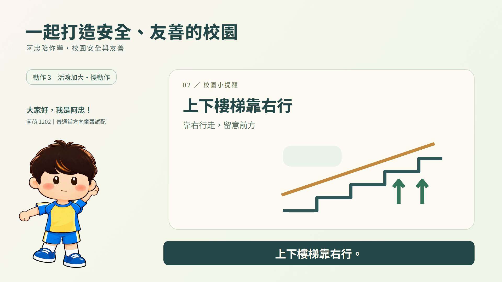

# 數字人對嘴語音專案

[公開Pages：三組完成示範](https://t92016.github.io/digital-human-avatar-workflow/) · [Agent純文字入口](agent.md) · [另一台電腦／OpenCode操作指南](docs/另一台電腦與OpenCode操作指南.md)

本repo保存目前已完成的Q版數位人工作流、固定依賴、模型下載／相容修正腳本、對嘴／眨眼／肢體程式與驗證紀錄。使用者已明確要求公開展示以下三組，每組各三種動作；影片保留原位元組。大型權重、原始照片、私人可編輯圖集、模型環境與憑證不隨Git上傳。

| 完成示範 | 內容 | 動作 |
| --- | --- | --- |
| [阿忠介紹校園安全](https://t92016.github.io/digital-human-avatar-workflow/showcases/azhong/) | 阿忠校服身體、萌萌1202，13.125秒 | 只有手部／自然版／活潑版 |
| [阿德＋阿忠身體反霸凌](https://t92016.github.io/digital-human-avatar-workflow/showcases/ade-school/) | 保留原換頭版本、家豪1602，13秒 | 同上 |
| [阿德本人身體反霸凌](https://t92016.github.io/digital-human-avatar-workflow/showcases/ade-personal/) | 本人服裝、完整SadTalker嘴型／局部眨眼／減小彎肘，13秒 | 同上 |

部署相同環境先準備Python3.12、Node.js22以上、Git及uv，於repo根目錄執行：

```powershell
.\scripts\setup.ps1 -PythonCommand python -RenderTools
.\.venv\Scripts\python.exe -m avatar_workflow doctor
# 需要本機對嘴時，再建立獨立Python3.10 CPU環境並下載必要權重：
.\scripts\setup-sadtalker-cpu.ps1
```

權重下載URL、revision、精確大小及SHA256在config/sadtalker-models.json，約1.10GiB由本機另行下載。OpenCode可直接讀根目錄AGENTS.md；其他Agent可從agent.md開始。觀看成品不需安裝；要重建同角色還需另取得授權私人素材，公開MP4不是可編輯骨架。新的本機TTS／生圖仍屬待介接候選，詳見最新專案進度，不將展示配音誤稱已由本機模型生成。

網站為根目錄靜態HTML／CSS／JS，Pages使用main分支根目錄與.nojekyll。`python scripts/verify-publication.py`核對九支影片與連結，`python scripts/secret-scan.py`掃描公開候選；`scripts/shutdown-sync.ps1`及[可攜收工Skill](skills/shutdown-sync/SKILL.md)供收尾，預設不提交／推送。以下保留各輪歷史操作與研究；最新已完成／未完成狀態以專案進度為準。

以全身照、半身照、大頭照或現成卡通角色製作Q版數字人，搭配台灣華語或英文語音、嘴型同步、繁體字幕及配合主題的教學背景，用於教學與宣導影片。全身輸入預設保留其身體／服裝；只有使用者指定才換成所提供的卡通身體，缺全身參考時先確認補繪，不默認阿忠制服。

## 已驗收示範：阿忠 × 萌萌 1202

使用者已接受這版聲音與動作，保留為專案固定示範。三種模式皆為 1080p／24 fps／13.125 秒，使用相同萌萌 1202 配音、繁體字幕與教學背景。

[](examples/azhong-mmeng-1202/media/mode2_natural.mp4)

- [① 只有手部](examples/azhong-mmeng-1202/media/mode1_hands.mp4)
- [② 手腳與頭部](examples/azhong-mmeng-1202/media/mode2_natural.mp4)
- [③ 活潑式](examples/azhong-mmeng-1202/media/mode3_lively.mp4)
- [互動比較頁](examples/azhong-mmeng-1202/index.html) · [觀看與重建說明](examples/azhong-mmeng-1202/README.md)

在GitHub可從上述連結開啟原凍結影片，也可由本repo的Pages入口切換三種動作；原示範manifest的prepared-locally字樣保留為生成時快照，發布狀態以專案進度為準。觀看示範不需安裝模型。示範以原影片與配音凍結，驗收範圍及雜湊見[manifest](examples/azhong-mmeng-1202/manifest.json)。本機檢查可用 `python scripts/verify-demo.py`。新人物流程見[固定身體範本與角色製作分流](docs/固定身體範本與角色製作分流.md)。

## 目標能力

- 互動選擇頭像、全身或頭像延伸全身，以及 Q 版風格。
- 真人照片以 GPT Image 2.5 生圖能力轉換，現有 Q 版角色可直接沿用。
- 提供可試聽的男女聲選單，區分台灣華語、其他華語及英文口音。
- 由已確認台詞產生語音，驅動角色嘴型，加入繁體中文或英文字幕。
- 依腳本分鏡搭配教學背景，合成可檢查與修改的解說影片。
- 全身角色提供三種動作模式：只有手部、手腳與頭部微幅動作、手腳與頭部活潑動作；三種皆依台詞對嘴。
- 角色位置及大小由使用者選擇，例如左下角；角色在指定區域內做原地動作，不在畫面中四處走動。教學背景、文字及講解聲音優先，避免角色遮擋教材與字幕。

## 專案文件

- `AGENTS.md`：協作、閱讀順序、品質與憑證規範。
- `專案進度.md`：唯一跨 Agent 進度與交接來源。
- `docs/`：按需要保存需求、研究、架構與決策。

通用需求與公開架構：[通用教學影片工作流與公開發布規劃](docs/通用教學影片工作流與公開發布規劃.md)。保留使用者／Agent提供台詞與背景的兩種來源、三種動作、逐步驗收與品質優先；最終為GitHub來源及Pages靜態說明／展示，模型在本機執行。通用任意作品入口、完整換機包及公開部署尚未完成。

本機生圖備援：[千問生圖、角色多視角與LoRA研究](docs/本機生圖與角色多視角資產研究_2026-10-24.md)。Edit-2511／2512與新版2.1／Turbo的用途、授權及資源分開記錄；多視角圖片庫不等於LoRA或3D骨架。這些仍是候選，沒有安裝或本角色品質實測。

目前研究：[方案研究與建議（2026-10-23）](docs/方案研究與建議_2026-10-23.md)，包含八種風格、二十款中英文聲線、三種全身角色動作選項及對嘴／影片架構建議。

免費工具研究：[免費開源影音工具評估](docs/免費開源影音工具評估_2026-10-23.md)，包含 GitHub 星數、授權、硬體適配、安全查核範圍與第一輪素材驗證快照。

操作與搬移：[硬體自適應與跨電腦工作流](docs/硬體自適應與跨電腦工作流.md)，包含自動檢測、模型推薦門檻、Windows 安裝、GitHub／私人 Drive 分工、素材包與重跑方式。

兒童配音與修改版：[兒童聲線選單與第二輪製作](docs/兒童聲線選單與第二輪製作.md)，整理男童／女童各四款官方候選、台灣少年音備選，以及本輪免費童趣男聲、左手慢舉與加大動作的製作方式。

最新聲線與關節修復：[台灣與免費兒童聲線及手部修復](docs/台灣與免費兒童聲線及手部修復_2026-10-23.md)。使用者目前以**免註冊、免申請 API** 為條件，接受普通話；已核對 TTSMaker 三款男童、四款女童，網站轉換有驗證碼，尚未自動介接。VoAI 五款台灣兒童角色保留候選，未接通。第三輪改為完整袖子隨手臂轉動、肩膀重疊的分層 rig。

## 已實作的原型

新作品配音依 `config/speech-policy.json` 優先開發本機TTS，台灣口音優先，成人男女及男童／女童均須試聽後選定；目前本機模型尚未安裝／接通。BreezyVoice為台灣華語候選，Qwen3-TTS為預設中文／聲音設計備選，不能把候選當成已完成聲音庫。已接受音檔照舊，詳見 [TTSMaker限制與本機轉向評估](docs/TTSMaker限制與本機語音轉向評估_2026-10-24.md)。

TTSMaker保留為備援，仍提供 **23 款聲線：男童3、女童4、成人男女各8**，附名稱、編號與口音。官方明列台灣者優先，港台風格另標。選單來源為 `config/ttsmaker-voices.json`，以下voices命令只列網站備援聲音，不代表呼叫本機TTS。免費方案有字元額度，生成仍可能需要驗證碼與排隊。

```powershell
.\.venv\Scripts\python.exe -m avatar_workflow voices
.\.venv\Scripts\python.exe -m avatar_workflow voices --html outputs/聲音選單.html
.\.venv\Scripts\python.exe -m avatar_workflow templates
```

阿忠第三輪身體動作已獲使用者接受，保留為 `azhong-school-v1` 可選範本。依最新需求，全身照預設製作本人Q版身體，現成卡通保留其身體；使用者指定固定身體時才只製作配合其畫風的新頭像。半身／大頭要求全身而缺參考時，先確認服裝及補繪。[固定身體範本與分流](docs/固定身體範本與角色製作分流.md) 說明素材、頭像接點與仍需校準的範圍。範本規格可隨repo，私人人物圖由素材包提供；templates命令只是選單，尚非自動製作器。

目前提供可重跑的Python／Node工作流；互動Skill、通用新作品入口及大型GPU模型介接尚未完成。已驗收阿忠示範保留原TTSMaker萌萌1202、早期Rhubarb／SVG嘴型及GSAP肢體。新人物主要對嘴方向為本機SadTalker；阿德第十一輪本人服裝13秒三模式、減少彎肘及整合嘴型／眨眼已獲接受。不能因弱硬體把舊2D嘴型重新套到阿德。人物分層、接合與眼部區域均須逐角色校準，任意新照片仍需短測，最新範圍看專案進度。

每台電腦先重新檢測，依實際 RAM、VRAM、架構、驅動與可用空間推薦輕量方案或大型模型候選。推薦不等於已驗證推論成功，不自動安裝大型權重、付費、上傳私人素材或部署。

```powershell
# Windows：準備 Python 3.12 與 Node.js 22 以上。
.\scripts\setup.ps1 -PythonCommand python -RenderTools
.\.venv\Scripts\python.exe -m avatar_workflow doctor
```

若另一台電腦要重新渲染或套用阿忠身體，須另取得私人素材包並匯入；`examples/azhong-mmeng-1202/` 只含使用者指定保留的展示成品，未包含可編輯身體圖集。僅觀看示範無須素材包。

```powershell
.\.venv\Scripts\python.exe -m avatar_workflow unpack '素材包路徑\round01_asset_pack.zip'
node scripts/build-sample.cjs
.\.venv\Scripts\python.exe -m unittest discover -s tests -v
npm.cmd test
node scripts/hf.cjs check samples/round01/mode1 --snapshots
node scripts/hf.cjs preview samples/round01/mode1 --background --port 3017
```

三種模式的來源均由 `video/composition.cjs` 建立；`config/round01.json` 保存第一輪設定。換聲音或台詞後須重做嘴型與字幕，語音驗收後才固定正式時間軸。早期試配保留當時狀態，第四輪使用者驗收另記於固定示範；程式檢查通過本身不等於主觀品質已接受。

新人物可用選用的頭身縮放、短頸接合與頭部轉軸設定；新主題由`presentation`提供標題、三個教材面板與字幕定位詞。`video_timing`可加入片頭／片尾停頓，音訊、嘴型及字幕一起位移，原聲語速不變。反霸凌樣本設定為`config/round05.json`，實際人物圖與配音保留在私人輸出目錄，不能只憑repo設定重建。規格見[新頭像與反霸凌短片設計](docs/新頭像與反霸凌短片設計.md)。

第二輪設定獨立保存於 `config/round02.json`，沿用人物、台詞、位置及大小，改為四次慢速舉左手與三種較大幅度動作，配音為 `zh-CN-YunxiaNeural` 童趣男聲（普通話，非台灣口音、未公開年齡）。第一輪輸出保留。

```powershell
node scripts/build-sample.cjs round02
$env:AVATAR_TEST_ROUND='round02'
npm.cmd test
.\.venv\Scripts\python.exe scripts/verify-videos.py --round round02
.\.venv\Scripts\python.exe -m avatar_workflow pack --round round02
```

第二輪的比較播放器及三支影片位於 `outputs/round02/`；素材包為 `outputs/round02_asset_pack.zip`，匯入命令不變，會依 manifest 輪次驗證。上面的 build／verify 須先有該輪素材／影片；不要把聲線研究候選當成已取得其 API 權限。

第三輪以 `config/round03.json` 修復大角度舉手的肩膀斷口，沿用原本的腳部參數、位置及大小；圖集用內建生圖工具補繪，SVG／GSAP 負責連續轉動。**此輪暫用第一輪台灣成人男聲，只驗證手部；不是已完成的兒童配音版。**

```powershell
node scripts/build-sample.cjs round03
$env:AVATAR_TEST_ROUND='round03'
npm.cmd test
node scripts/check-arm-continuity.cjs
.\.venv\Scripts\python.exe scripts/verify-videos.py --round round03
.\.venv\Scripts\python.exe -m avatar_workflow pack --round round03
```

第三輪比較播放器位於 `outputs/round03/三種動作比較.html`，三支 MP4 同目錄；`outputs/round03_asset_pack.zip` 包含 10 個允許清單素材（增加肩部／軀幹圖集），不含影片。`check-arm-continuity` 擷取 108 張透明角色畫面，檢查關節與像素連通性，不取代目視與使用者驗收。換童聲需另建輪次並重建時間。

第四輪已實際使用 **TTSMaker 萌萌1202** 免費配音，原WAV約13.084秒，沿用已接受動作，重建97段近似嘴型cue及9段繁體字幕。使用者已觀看並接受聲音與動作，成品另存到 `examples/azhong-mmeng-1202/` 作為固定示範。原三支MP4與測試播放器仍在 `outputs/round04/`，未覆寫或轉碼；原頁與speech資料的「待驗收」是生成時快照。未註冊或使用API金鑰。

外部配音可由 `scripts/transcribe-local.py` 以 CPU／int8 的 Whisper tiny 產生音訊詞界，再用 `python -m avatar_workflow import-speech` 驗證匯入；這是近似時間，辨識不符需校稿，不平均分配字幕。基本依賴不強制安裝 ASR；需要重做外部音檔時間時才安裝 `requirements-alignment.lock.txt`。模型約75.5MB權重，放在忽略的 `models/`，不向外傳送音訊。完整步驟及23款清單見 [TTSMaker聲音選單與第四輪試配](docs/TTSMaker聲音選單與第四輪試配.md)。

## 素材與產出位置

既有兩組展示影片可另整理成方便介紹的命名副本，執行 `python scripts/export-presentation-videos.py`。需要本機已有阿忠固定示範、第五輪MP4及FFprobe；命令將六支MP4複製到專案根目錄的「阿忠介紹校園安全」「阿德推廣校園反霸凌（阿忠身體）」，按三種動作命名，逐檔核對雜湊及影音規格，不重新壓縮，遇到不同內容不覆寫。阿德舊資料夾已依使用者要求改為上述括號名稱，原MP4不變；這個匯出命令不會重新建立舊名。副本資料夾均Git忽略，不擴大原示範公開範圍。

本人服裝的完整反霸凌版另存「阿德推廣校園反霸凌（個人身體）」，內含三支13秒／1920×1080／24fps MP4及index.html，可直接開啟本機頁面，或以 `python scripts/serve-demo.py --directory '阿德推廣校園反霸凌（個人身體）' --port 3034` 啟動白名單預覽。來源為config/round11.json與build-personal-body-teaching.cjs，保留第五輪原聲／台詞／字幕／教材，僅替換專屬身體、減少彎肘及使用完整原音驅動的SadTalker頭像。完整推論入口run-sadtalker-full-dialogue.py與原3～5秒試驗分開，限已確認原音的5～30秒候選；不是任意長度自動推論承諾。最後逐幀驗證通過後，finalize-personal-teaching.ps1才匯出並依原檔雜湊安全改名。

改進頭像嘴型的來源與選型見[自然對嘴方案研究（2026-10-24）](docs/自然對嘴方案研究_2026-10-24.md)。本機免費模型、線上示範額度及本角色品質分別驗證，不能將共享GPU網頁可開啟視為無限免費生成。

### SadTalker 原嘴頭像短測

選用本機 SadTalker 時，先重新執行 doctor，再使用獨立 Python 3.10 CPU 環境，不將舊模型依賴裝入主 `.venv`。需要 uv、Git，以及原專案工具安裝提供的 FFmpeg／FFprobe。安裝腳本只取固定 commit、四個必要權重及鎖定套件，模型約1.10 GiB；不啟用 GFPGAN 美顏，不要求帳號或 API key。

```powershell
.\.venv\Scripts\python.exe -m avatar_workflow doctor
.\scripts\setup-sadtalker-cpu.ps1
.\.venv\Scripts\python.exe scripts/run-sadtalker-head-test.py --image outputs/round05/character/head_closed_v1.png --audio outputs/round05/audio/ttsmaker_original.wav --output outputs/round06/新版本名稱 --seconds 4.4
```

範例需要本機已有私人頭像／音訊；換人時改成已驗收的 Q 版 PNG 與音檔。輸出目錄須為新版本，不覆寫舊試驗。這個入口刻意只允許3～5秒小樣，並非 SadTalker 的音訊長度上限；長片仍需評估分段、記憶體與耗時。對嘴使用音訊，不會產生語音，也不會消除 TTSMaker 本身的網站限制。模型會重建嘴唇及下顎細節，需比較原頭像、張合、停頓與身份，接受後才接回身體。安裝細節與實測見 [SadTalker本機嘴型實測與踩坑](docs/SadTalker本機嘴型實測與踩坑_2026-10-24.md)。

已接受的固定頭像若有小幅整體位移，可用 `work/sadtalker/venv/Scripts/python.exe scripts/stabilize-sadtalker-head.py --input 原片路徑 --output outputs/新版本/head_stabilized.mp4` 另存候選。此工具只校正小幅頭像位移，頭髮ROI須逐角色校準，不適用於整張教材或刻意移動的全身成片。原生隨機眨眼對Q版大眼可能反應弱；增益過大會改變全臉，不能當成只控制眼皮。流程、診斷命令及採用／放棄理由見 [跳動與眨眼踩坑及優化紀錄](docs/SadTalker跳動與眨眼踩坑及優化紀錄_2026-10-24.md)。每項優化都保存方法、參數與實測限制，當前驗收集中於 `專案進度.md`。

阿德局部眨眼另用 `scripts/compose-local-blink.py`，以原穩定片的逐幀眼球搭配生成眼皮材質做局部遮擋，不再提高SadTalker全臉眨眼增益。`config/ade-blink-round08.json` 僅校準此角色；需要私人穩定片及眼皮素材，repo本身不能獨立重建。先用 `--keyframes-only` 檢視開／半／閉眼，再用新的 `--output outputs/新版本` 輸出，原MP4存在時拒絕覆寫。比較頁由 `scripts/build-local-blink-preview.py --directory outputs/新版本` 建立，再以 `scripts/serve-demo.py --directory outputs/新版本 --port 3029` 本機預覽。具體參數、眼線殘影修正及實際驗證見 [Q版大眼短測規格與踩坑](docs/Q版大眼局部眨眼短測規格_2026-10-24.md)。

同一專案換新對話時，先讀三份核心文件及 `專案進度.md` 的「新對話接續入口」，再讀其餘專案Markdown；不另建第二份handoff。眨眼最新驗收及下一步仍以專案進度為準。

阿德本人全身照另有專屬黑POLO／長褲工作流，來源為 `config/round09.json`。`scripts/build-custom-fullbody-sample.cjs` 將生成圖集以原生SVG剪裁為六部位，保留完整袖子與肩／髖重疊，再搭配已接受頭像；需要本機私人素材與 `head_accepted_alpha.webm`，不是任意全身照自動綁定入口。以 `scripts/verify-custom-fullbody.py` 檢查實際三支MP4；`scripts/build-custom-fullbody-preview.py` 建立本機比較頁與身體部位ZIP，使用 `scripts/serve-demo.py --directory outputs/round09 --port 3030` 預覽。素材、頭身接合及新動作須另行驗收，詳見 [專屬全身整合踩坑](docs/全身照專屬Q版與頭身整合踩坑_2026-10-24.md)。

連續彎肘／屈膝使用 `config/round10.json`、`video/articulated-puppet.js` 與 `scripts/build-articulated-fullbody.cjs`，在原材質上做共享頂點網格變形，頭身與肩髖共用定位，三模式分別建於 `samples/round10/`。依序檢查幾何、擷取並檢查每幀透明alpha、檢查實際MP4，最後執行 `scripts/build-articulated-preview.py`；比較頁由 `scripts/serve-demo.py --directory outputs/round10 --port 3032` 提供。交付候選為 `mode1-final.mp4`／`mode2-final.mp4`／`mode3-final.mp4`，保留初版及第九輪原片。此工作流需要可用WebGL與本機私人來源；只驗證既有4.4秒素材，關節及新比例仍須逐輪審核。

- `private_inputs/`：私人照片、聲音及輸入素材，Git 忽略。
- `素材照片/`：使用者放入的原始素材，Git 忽略並保留原檔。
- `work/`：中間檔與快取，Git 忽略。
- `outputs/`：生成影片、圖片與音訊，Git 忽略。
- `examples/azhong-mmeng-1202/`：使用者指定保存、供未來 repo 展示的已驗收成品與比較頁，不在忽略範圍；不含原始照片與可編輯私人圖集。後續作品仍預設忽略。
- `samples/round01/`：由來源產生的 HyperFrames 三種模式專案，包含私人角色與聲音，Git 忽略。
- `samples/round02/`：第二輪三種慢速加大動作的生成專案，同樣忽略。
- `samples/round03/`：第三輪肩部修復與連續性檢查專案，同樣忽略。
- `samples/round04/`：第四輪萌萌配音比較專案，同樣忽略。
- `tools/bin/`、`.venv/`、`node_modules/`：本機工具與依賴，Git 忽略；換機重新安裝。
- `assets/fonts/`：可散布的 Noto Sans TC 與 OFL 授權，可隨 repo 保存。

Edge-TTS 是需連網的非官方用戶端；中文 Rhubarb 嘴型為近似結果，需要人工校正。安全查核狀態與最新實測結果見 `專案進度.md`。
